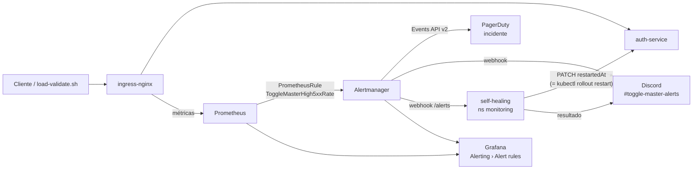

# Alertas Inteligentes e Self-Healing — Fase 4 (Parte 4)

Alerta de taxa de erros HTTP 5xx → **Alertmanager** → incidente no **PagerDuty** + mensagem no **Discord** (ChatOps)
+ **self-healing** automático (`rollout restart` do deployment afetado). Tudo provisionado via GitOps (Argo CD);
os segredos das integrações vêm do Terraform `platform` e nunca entram no Git.

## Arquitetura



| Peça | Onde |
|---|---|
| Alertmanager (rotas, receivers, inibição, templates Discord/PagerDuty) | [`aws/monitoring/kube-prometheus-stack/values.yaml`](../aws/monitoring/kube-prometheus-stack/values.yaml) (`alertmanager:`) |
| Regras de alerta + recording rules | [`aws/monitoring/alerting/toggle-master-rules.yaml`](../aws/monitoring/alerting/toggle-master-rules.yaml) — Application `monitoring-alerting` |
| Receiver de self-healing (script, RBAC, Deployment, Service) | [`aws/monitoring/self-healing/`](../aws/monitoring/self-healing/) — Application `self-healing` |
| Secret `alertmanager-integrations` (routing key + webhook) | [`terraform/platform/main.tf`](../terraform/platform/main.tf) |
| Injeção de falha (chaos) | `auth-service`: `POST/DELETE/GET /admin/chaos` (só com `CHAOS_ENABLED=true`, protegido pela `MASTER_KEY`) |
| Scripts da demo | [`scripts/demo/`](../scripts/demo/) |

### Regras

| Alerta | Condição | Severidade | Destino |
|---|---|---|---|
| `ToggleMasterHigh5xxRate` | 5xx / total (ingress, por serviço, janela 2m) **> 5%** por **1m**, com tráfego > 0,1 req/s | `critical` | PagerDuty + Discord + self-healing |
| `ToggleMaster5xxRateWarning` | mesma razão **> 1%** por **5m** | `warning` | só Discord |

As regras valem para os 5 serviços (label `exported_service` das métricas do ingress). O label `deployment` do alerta
é o nome do serviço, que no projeto é igual ao nome do Deployment.

### Como o self-healing funciona

1. O Alertmanager chama `http://self-healing.monitoring.svc:8080/alerts` (receiver `oncall`).
2. O [`self_healing.py`](../aws/monitoring/self-healing/self_healing.py) (Python só com stdlib, imagem `python:3.12.12-slim`)
   só age em alertas `firing` com `self_heal="true"` e `deployment` na allowlist.
3. Faz `PATCH` na annotation `kubectl.kubernetes.io/restartedAt` do pod template — exatamente o que
   `kubectl rollout restart` faz — usando a ServiceAccount `self-healing`, que só tem `get`/`patch` nos 5 Deployments do
   namespace `toggle-master` (Role com `resourceNames`).
4. **Cooldown de 5 min por deployment**: evita loop de restart se a causa não for resolvida pelo restart.
5. Loga em JSON (`restart_started`, `restart_succeeded`, `restart_skipped`…) → OTel Collector (filelog) → Loki, e posta o resultado no Discord.
6. Se o PATCH falhar responde `502`, e o Alertmanager reenvia a notificação.

## Anti alert fatigue

- **Sintoma, não causa**: alerta sobre o que o usuário sente (taxa de 5xx), não sobre CPU/pod reiniciando.
- **Razão + tráfego mínimo**: 5% de erro com tráfego desprezível não acorda ninguém.
- **`for:`** evita disparo por pico isolado (1m para crítico, 5m para warning).
- **Severidade define o canal**: só `critical` pagina no PagerDuty; `warning` vai só para o Discord.
- **Inibição**: com o crítico ativo, o warning do mesmo serviço é suprimido.
- **Agrupamento** por `alertname` + `exported_service`, `repeat_interval: 4h`; `Watchdog` e regras padrão do cluster
  vão para o receiver `null`.
- **`send_resolved`**: o incidente no PagerDuty é resolvido sozinho quando a taxa normaliza.

## Setup

### 1. PagerDuty
1. Crie uma conta (plano Free) e um **Service** `ToggleMaster`.
2. Em *Integrations* adicione **Events API V2** e copie a **Integration Key** (routing key).
3. (Opcional) Instale o app do PagerDuty no Discord/Slack — não é necessário, o Discord já recebe do Alertmanager.

### 2. Discord
Canal → *Editar canal* → *Integrações* → *Webhooks* → *Novo webhook* → **Copiar URL do webhook**.

### 3. Terraform `platform`
Em `terraform/platform/terraform.tfvars` (gitignored):

```hcl
pagerduty_routing_key = "<integration key>"
discord_webhook_url   = "https://discord.com/api/webhooks/..."
```

```bash
terraform -chdir=terraform/platform apply
```

O Terraform cria o namespace `monitoring` e o Secret `alertmanager-integrations` **antes** do Argo CD.
Se o cluster já existia com o namespace `monitoring` criado pelo Argo CD, importe-o antes do apply:

```bash
terraform -chdir=terraform/platform import kubernetes_namespace_v1.monitoring monitoring
```

Trocou a chave/webhook depois? `terraform apply` de novo e reinicie o Alertmanager:
`kubectl -n monitoring rollout restart statefulset alertmanager-kube-prometheus-stack-alertmanager`.

### 4. Imagem do auth-service com o endpoint de chaos
Merge da branch `feat/chaos-fault-injection` no `auth-service` → o CI publica a imagem e faz o bump em
`aws/apps/auth-service/kustomization.yaml`. O manifest já tem `CHAOS_ENABLED=true`.

## Validação

```bash
kubectl -n argocd get applications
# kube-prometheus-stack, monitoring-alerting, self-healing → Synced / Healthy

kubectl -n monitoring get pods
# alertmanager-kube-prometheus-stack-alertmanager-0 e self-healing-* → Running

kubectl -n monitoring get prometheusrule toggle-master-alerts
kubectl -n monitoring logs deploy/self-healing
# {"event": "server_started", ... "allowed_deployments": [...]}
```

Grafana (`kubectl -n monitoring port-forward svc/kube-prometheus-stack-grafana 3000:80`) → **Alerting › Alert rules**:
as regras `ToggleMasterHigh5xxRate` e `ToggleMaster5xxRateWarning` aparecem no datasource Prometheus.
Alertmanager: `kubectl -n monitoring port-forward svc/kube-prometheus-stack-alertmanager 9093`.

## Roteiro da demo (vídeo — "a prova real")

Deixe 3 terminais abertos:

```bash
# T1 — pods do auth sendo recriados
kubectl -n toggle-master get pods -l app=auth-service -w

# T2 — tráfego contínuo em /validate (mostra 200 → 500 → 200)
./scripts/demo/load-validate.sh

# T3 — logs do self-healing
kubectl -n monitoring logs -f deploy/self-healing
```

1. Com tráfego estável (só `200`), injete a falha em todos os pods do auth:
   ```bash
   ./scripts/demo/auth-fault.sh on
   ```
   T2 passa a mostrar `500`.
2. Grafana › Alerting: `ToggleMasterHigh5xxRate` vai de **Normal → Pending → Firing** (~1–2 min).
   Dashboard ToggleMaster Overview: painel "Taxa HTTP 5xx" sobe; Loki: `{k8s_namespace_name="toggle-master", k8s_container_name="auth-service"} |= "Chaos"`.
3. **PagerDuty**: incidente `[ToggleMaster] ToggleMasterHigh5xxRate em auth-service` aberto automaticamente.
4. **Discord**: mensagem `[FIRING:1] ToggleMasterHigh5xxRate — auth-service` com resumo, valor, runbook e link da query.
5. **Self-healing**: T3 mostra `restart_started` → `restart_succeeded`; T1 mostra pods novos subindo e os antigos
   terminando; Discord recebe "🛠️ Self-healing executado — kubectl rollout restart deployment/auth-service".
   Confirme também: `kubectl -n toggle-master rollout history deploy/auth-service`.
6. Pods novos começam sem a falha (o estado é em memória) → T2 volta a `200` → alerta **Resolved** no Grafana,
   mensagem `[RESOLVED]` no Discord e incidente resolvido no PagerDuty.
7. Confira que o Argo CD continua `Synced` após o restart (a annotation `restartedAt` não está no Git; é o mesmo campo que a ação *Restart* do próprio Argo CD usa).

Se precisar desligar a falha manualmente: `./scripts/demo/auth-fault.sh off`.

## Runbook: ToggleMasterHigh5xxRate

1. Verifique se o self-healing já agiu: `kubectl -n monitoring logs deploy/self-healing | grep <serviço>`.
2. Se o alerta continuar após o restart (cooldown de 5 min), a causa não é estado do pod: veja os logs no Loki
   (`{k8s_namespace_name="toggle-master", k8s_container_name="<serviço>"}`), dependências (RDS, Redis, auth-service) e o último deploy no Argo CD.
3. Rollback se o problema veio de deploy: reverta o commit de bump da imagem no `toggle-master-infra`.

## Runbook: ToggleMaster5xxRateWarning

Degradação leve e sustentada. Não pagina e não reinicia nada: investigue os logs no Loki e o dashboard; se piorar,
o alerta crítico assume.

## Evidências para o relatório

- [ ] Print do Grafana › Alerting com `ToggleMasterHigh5xxRate` em **Firing**
- [ ] Print do incidente aberto no PagerDuty
- [ ] Print da notificação no Discord (FIRING + self-healing + RESOLVED)
- [ ] Print do log do self-healing (`restart_succeeded`) e do `kubectl get pods -w` com os pods novos

## Justificativa técnica

**PagerDuty em vez de OpsGenie**: a Atlassian encerrou a venda do OpsGenie (jun/2025) e o produto sai do ar em
abr/2027; o PagerDuty tem plano Free, integração nativa no Alertmanager (`pagerduty_configs`, Events API v2) e
resolve o incidente sozinho com `send_resolved`.

**Alertmanager em vez de Grafana-managed alerts**: as regras ficam como `PrometheusRule` versionadas no Git e
aplicadas pelo Argo CD (GitOps de ponta a ponta), o Alertmanager já vem no kube-prometheus-stack e tem receivers
nativos para PagerDuty, Discord e webhook. O Grafana continua mostrando o estado das regras (Firing/Resolved).

**Self-healing dentro do cluster** em vez de Lambda/GitHub Action: no AWS Academy não há IRSA e as credenciais
expiram a cada sessão; um receiver no próprio cluster não precisa de credencial AWS, não expõe nada na internet e
usa RBAC mínimo (só `patch` nos 5 Deployments).
