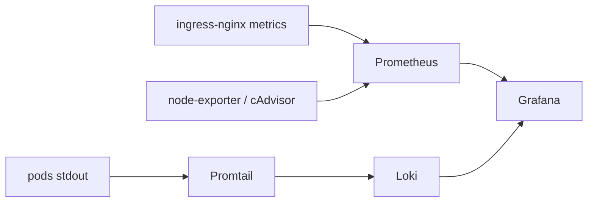

# Monitoramento Opensource — Fase 4 (Parte 1)

Stack **Prometheus + Loki + Grafana** no EKS, provisionada via **GitOps (Argo CD + Helm)**.
OTel Collector e APM ficam nas partes seguintes; alertas e self-healing estão em [ALERTING-SELF-HEALING.md](ALERTING-SELF-HEALING.md).

## Arquitetura



| Componente | Onde | Chart / path |
|---|---|---|
| Prometheus + Grafana + kube-state-metrics + node-exporter | Application `kube-prometheus-stack` | `prometheus-community/kube-prometheus-stack` `92.22.0` + [`aws/monitoring/kube-prometheus-stack/values.yaml`](../aws/monitoring/kube-prometheus-stack/values.yaml) |
| Loki (SingleBinary, filesystem) | Application `loki` | `grafana/loki` `6.55.0` + [`aws/monitoring/loki/values.yaml`](../aws/monitoring/loki/values.yaml) |
| Promtail | Application `promtail` | `grafana/promtail` `6.17.1` + [`aws/monitoring/promtail/values.yaml`](../aws/monitoring/promtail/values.yaml) |
| Dashboard + ServiceMonitor ingress | Application `monitoring-dashboards` | [`aws/monitoring/dashboards/`](../aws/monitoring/dashboards/) |

Namespace: **`monitoring`**. Taxa de requisições dos microsserviços vem das métricas do **ingress-nginx** (as apps ainda não expõem `/metrics` — isso entra com OTel/APM).

## Pré-requisitos de infra

1. Disco dos nós **40 GiB** (`eks_node_disk_size` em `terraform/infra`) — PVCs de 5 GiB para Prometheus e Loki.
2. `controller.metrics.enabled = true` no `helm_release.ingress_nginx` (`terraform/platform`).
3. Push das Applications / values na `main` do `toggle-master-infra` (o root app do Argo já aponta para `aws/argocd/applications/`).

```bash
# se o lab já existia com disco 20 GiB:
terraform -chdir=terraform/infra apply
terraform -chdir=terraform/platform apply   # metrics do ingress
```

O node group recria nós ao mudar o launch template (disco). Aguarde os nós Ready antes de validar a stack.

## Validação

```bash
aws eks update-kubeconfig --region us-east-1 --name toggle-master-dev-eks

kubectl -n argocd get applications
# kube-prometheus-stack, loki, promtail, monitoring-dashboards → Synced / Healthy

kubectl -n monitoring get pods
# prometheus, grafana, loki, promtail, node-exporter, kube-state-metrics → Running

kubectl -n monitoring get pvc
# 5Gi prometheus + 5Gi loki Bound
```

### Grafana

```bash
kubectl -n monitoring port-forward svc/kube-prometheus-stack-grafana 3000:80
```

- URL: http://localhost:3000  
- Usuário: `admin`  
- Senha: `togglemaster` (values do chart; só para lab)

Datasources esperados: **Prometheus** (default do stack) e **Loki** (`http://loki.monitoring.svc:3100`).

Dashboard: **ToggleMaster Overview** (folder ToggleMaster) — CPU/memória do cluster, request rate por serviço/path via ingress, logs `{namespace="toggle-master"}`.

### Queries de exemplo

PromQL:

```promql
# CPU dos nós
1 - avg(rate(node_cpu_seconds_total{mode="idle"}[5m])) by (instance)

# Request rate por serviço (ingress)
sum(rate(nginx_ingress_controller_requests{exported_namespace="toggle-master"}[5m])) by (service)

# Erros 5xx
sum(rate(nginx_ingress_controller_requests{exported_namespace="toggle-master", status=~"5.."}[5m]))
```

LogQL:

```logql
{namespace="toggle-master"}
{namespace="toggle-master", app="auth-service"} |= "error"
```

### Tráfego de teste

```bash
LB=$(kubectl -n ingress-nginx get svc ingress-nginx-controller \
  -o jsonpath='{.status.loadBalancer.ingress[0].hostname}')

curl -sk "https://$LB/auth/health"
curl -sk "https://$LB/analytics/health"
curl -sk "https://$LB/evaluate?user_id=u1&flag_name=test-flag"
```

Depois disso o painel de request rate e o de logs devem se movimentar.

## Evidências (vídeo / relatório)

- [ ] `kubectl -n argocd get applications` com as 4 apps de monitoring Synced/Healthy
- [ ] Print do dashboard ToggleMaster Overview (CPU/mem + request rate + logs)
- [ ] Datasources Prometheus e Loki no Grafana
- [ ] Explique no vídeo: charts no Git sob `aws/monitoring/` + Applications multi-source; Argo sincroniza sozinho

## Limitações do lab

- Retenção Prometheus/Loki: **24 h**; PVCs **5 GiB**.
- Alertmanager ligado na Parte 4 — ver [ALERTING-SELF-HEALING.md](ALERTING-SELF-HEALING.md).
- Sem S3/IRSA no Loki — storage local no nó.
- Senha do Grafana em texto no values (aceitável no Academy; não use em produção).
