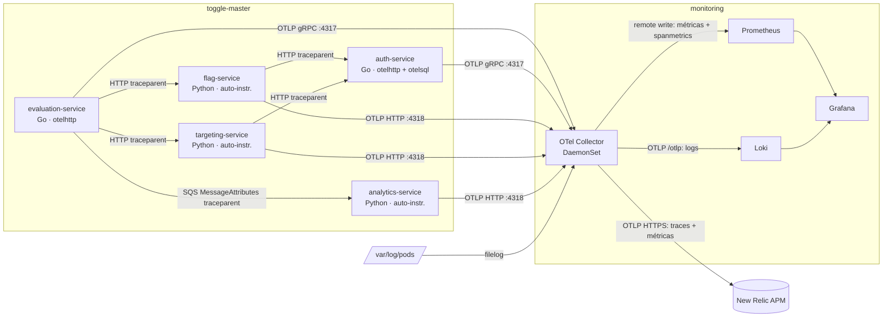

# OpenTelemetry Collector — Fase 4 (Parte 2)

O **OTel Collector** é o ponto central da telemetria. Os 5 microsserviços enviam traces e métricas por **OTLP**; os logs saem pelo stdout e o Collector lê os arquivos dos pods. Depois o Collector repassa cada sinal para o backend certo: **Prometheus**, **Loki** e **New Relic** (APM).

## Arquitetura



### Pipelines (`aws/monitoring/otel-collector/values.yaml`)

| Pipeline | Receivers | Processors | Exporters |
|---|---|---|---|
| `traces` | `otlp` | `k8sattributes`, `memory_limiter`, `resource`, `batch` | `otlphttp/newrelic`, connector `spanmetrics` |
| `metrics` | `otlp` | idem | `prometheusremotewrite`, `otlphttp/newrelic` |
| `metrics/spanmetrics` | `spanmetrics` | `memory_limiter`, `batch` | `prometheusremotewrite` |
| `logs` | `otlp`, `filelog` (preset) | `k8sattributes`, `memory_limiter`, `resource`, `batch` | `otlphttp/loki` |

- **`k8sattributes`** (preset): acrescenta `k8s.namespace.name`, `k8s.pod.name` e `k8s.deployment.name` a todo sinal. No Loki, esses atributos viram os labels `k8s_namespace_name` e `service_name`.
- **`spanmetrics`**: calcula métricas RED (requisições, erros e duração) a partir dos traces. Por isso o Grafana mostra request rate, taxa de erro e p95 por serviço sem instrumentar métricas à mão.
- **DaemonSet + `internalTrafficPolicy: Local`**: cada pod manda a telemetria para o Collector do próprio nó. O preset `logsCollection` substitui o Promtail sem acrescentar pods, o que importa no limite de 17 pods por nó do t3.medium.

### Instrumentação dos serviços

| Serviço | Como | Detalhes |
|---|---|---|
| evaluation-service (Go) | SDK manual (`otel.go`) | `otelhttp` no servidor e no cliente HTTP, spans manuais para Redis e SQS, `traceparent` injetado nos `MessageAttributes` do SQS |
| auth-service (Go) | SDK manual (`otel.go`) | `otelhttp` no servidor, `otelsql` no driver pgx (queries com `*Context`) |
| flag-service, targeting-service (Python) | `opentelemetry-instrument` no Dockerfile | Flask, requests (→ auth) e psycopg2 instrumentados automaticamente |
| analytics-service (Python) | `opentelemetry-instrument` + span CONSUMER manual | Lê o `traceparent` da mensagem SQS e continua o trace; o botocore instrumenta DynamoDB e SQS |

O Go usa OTLP/gRPC (4317) e o Python usa OTLP/HTTP (4318), porque o gRPC não funciona bem com o modelo de fork do gunicorn. Toda a configuração vem das variáveis `OTEL_*` dos Deployments em `aws/apps/*/`.

## Passo a passo

### 1. Conta New Relic e license key

1. Crie a conta gratuita em newrelic.com, que não expira.
2. Copie a chave em **API Keys → INGEST - LICENSE**.
3. Se a conta for da região **EU**, troque o endpoint em `values.yaml` para `https://otlp.eu01.nr-data.net`.

### 2. Secret via Terraform (fora do Git)

```hcl
# terraform/platform/terraform.tfvars (não versionado)
new_relic_license_key = "xxxxxxxxxxxxxxxxxxxxxxxxxxxxxxxxxxxxNRAL"
```

```bash
terraform -chdir=terraform/platform apply   # cria monitoring/otel-apm-credentials
```

### 3. Infra (GitOps)

1. Confirme a versão do chart (`targetRevision` em `aws/argocd/applications/otel-collector.yaml`):
   ```bash
   helm repo add open-telemetry https://open-telemetry.github.io/opentelemetry-helm-charts
   helm search repo open-telemetry/opentelemetry-collector
   # opcional: conferir o ConfigMap final gerado pelos presets
   helm template otel-collector open-telemetry/opentelemetry-collector \
     -f aws/monitoring/otel-collector/values.yaml | less
   ```
2. Faça push na `main`. O Argo cria a Application `otel-collector` (wave −1) e aplica `enableRemoteWriteReceiver` no Prometheus.

### 4. Serviços

- **Go** (evaluation, auth): rode `go mod tidy` para baixar os módulos OTel e atualizar o `go.mod`/`go.sum`, depois `go build ./... && go test ./...`.
  - Se o `tidy` subir a diretiva `go` acima de 1.25, atualize também o `FROM golang:` do Dockerfile e o `go-version` do CI. A imagem oficial do Go não baixa outro toolchain sozinha.
- **Python**: nada a rodar. `requirements.txt` e Dockerfile já instalam o distro e as instrumentações.
- Faça push em cada serviço. O CI gera a imagem e o `gitops-bump` atualiza a tag.

### 5. Desligar o Promtail (depois de validar os logs pelo Collector)

```bash
git rm aws/argocd/applications/promtail.yaml aws/monitoring/promtail/values.yaml
git commit -m "chore(monitoring): Promtail substituído pelo OTel Collector (filelog)"
```

Com os dois ligados, os logs ficam duplicados no Loki: o Promtail usa os labels `namespace`/`app` e o Collector usa `k8s_namespace_name`/`service_name`.

## Validação

### Automatizada

```bash
scripts/otel/validate-otel.sh static    # antes do push: helm template, otelcol validate (docker), kustomize, terraform fmt
scripts/otel/validate-otel.sh cluster   # no EKS: Argo, DaemonSet, secret, tráfego, spanmetrics no Prometheus, logs no Loki
FLAG=minha-flag scripts/otel/validate-otel.sh cluster   # use uma flag existente para respostas 200
```

### Manual

```bash
kubectl -n argocd get application otel-collector
kubectl -n monitoring get ds,pods -l app.kubernetes.io/name=opentelemetry-collector
kubectl -n monitoring get cm otel-collector-agent -o yaml   # config renderizada (o nome pode variar: kubectl -n monitoring get cm)
kubectl -n monitoring logs ds/otel-collector-agent --tail=50 # erros de export aparecem aqui

# gerar tráfego
LB=$(kubectl -n ingress-nginx get svc ingress-nginx-controller -o jsonpath='{.status.loadBalancer.ingress[0].hostname}')
for i in $(seq 1 50); do curl -sk "https://$LB/evaluate?user_id=u$i&flag_name=test-flag" >/dev/null; done
```

**Grafana (Explore):**

```promql
sum(rate(traces_span_metrics_calls_total{span_kind="SPAN_KIND_SERVER"}[5m])) by (service_name)
histogram_quantile(0.95, sum(rate(traces_span_metrics_duration_milliseconds_bucket[5m])) by (le, service_name))
sum(rate(http_server_request_duration_seconds_count[5m])) by (service_name)   # métrica do otelhttp (Go)
```

```logql
{k8s_namespace_name="toggle-master"}
{service_name="evaluation-service"} |= "Erro"
```

Os nomes das métricas vêm do `prometheusremotewrite`, que troca `.` por `_` e acrescenta sufixos de unidade e `_total`. Se alguma consulta vier vazia, procure o nome no Explore com `{__name__=~"traces_span.*"}`.

**New Relic:** APM & Services mostra os 5 serviços. O **Service Map** exibe evaluation → flag/targeting → auth, mais evaluation → analytics via SQS. O Distributed Tracing mostra o caminho de um `GET /evaluate`.

## Evidências para o vídeo e o relatório

- [ ] Application `otel-collector` Synced/Healthy no Argo CD
- [ ] ConfigMap do Collector aberto, explicando os pipelines: é o "como o OTel roteia"
- [ ] Painéis **OpenTelemetry (spanmetrics)** do dashboard ToggleMaster Overview com dados
- [ ] Logs no Loki com `{k8s_namespace_name="toggle-master"}`, incluindo `trace_id` nos logs Python
- [ ] Service Map e um trace distribuído no New Relic (Parte 3)

## Justificativa técnica (para o relatório)

- **Collector como DaemonSet**: um agente por nó cuida de OTLP e logs dos arquivos, substituindo o Promtail pelo mesmo número de pods. O tráfego OTLP fica no nó (`internalTrafficPolicy: Local`).
- **Distribuição contrib**: traz `filelog`, `k8sattributes`, `spanmetrics` e `prometheusremotewrite`.
- **SDK no código em vez do OTel Operator**: o Operator exige cert-manager e webhooks, ou seja, mais pods e memória do que os 2× t3.medium do AWS Academy comportam.
- **New Relic em vez de Datadog**: aceita OTLP nativo, então não precisa de Agent nem de exporter proprietário. O plano gratuito não expira, o que serve para um lab recriado várias vezes.
- **Sem IAM/IRSA**: nenhum exporter usa credencial AWS. A Academy só oferece a `LabRole`, então X-Ray, CloudWatch e AMP ficam de fora.

## Limitações do lab

- O Collector roda como root (`runAsUser: 0`) para ler `/var/log/pods`. O namespace `monitoring` não tem PSA restritiva.
- Se o pod do Collector de um nó estiver fora, a telemetria dos pods desse nó se perde (efeito do `internalTrafficPolicy: Local`).
- Retenção de 24 h no Prometheus e no Loki. Se o lab for resetado, o histórico some; o New Relic guarda os traces.
- Em dev local (docker-compose), use `OTEL_SDK_DISABLED=true` para não tentar exportar sem Collector.
