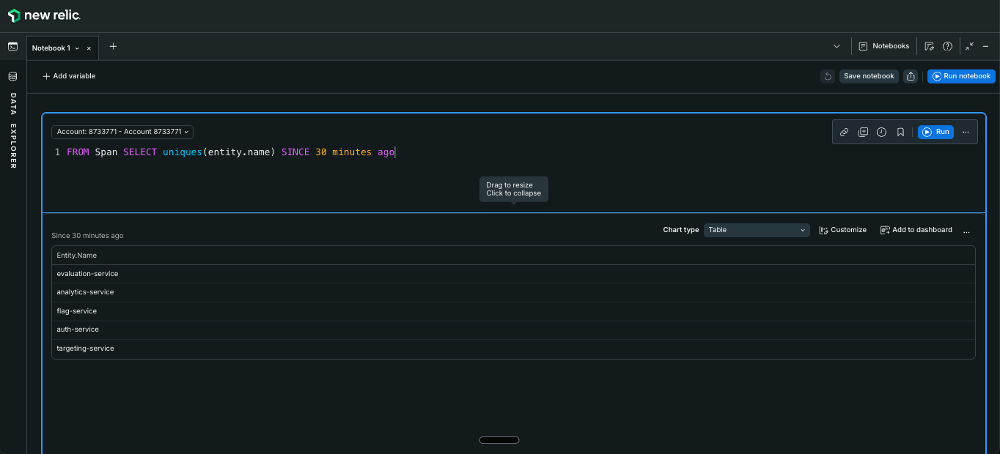
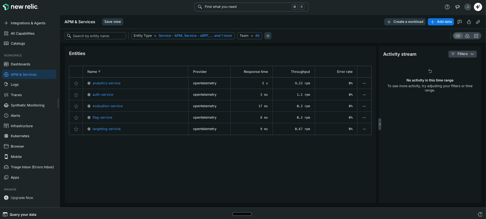
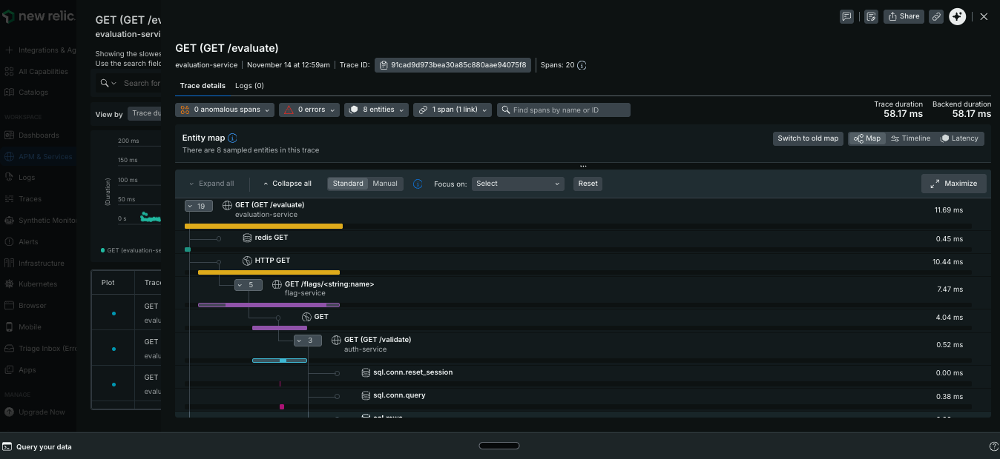
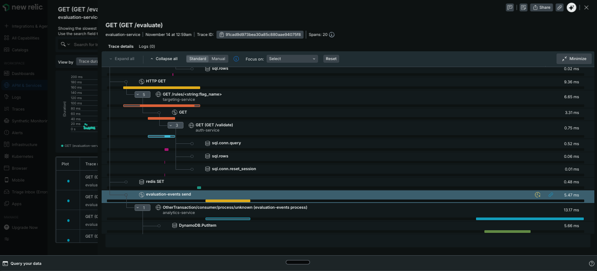
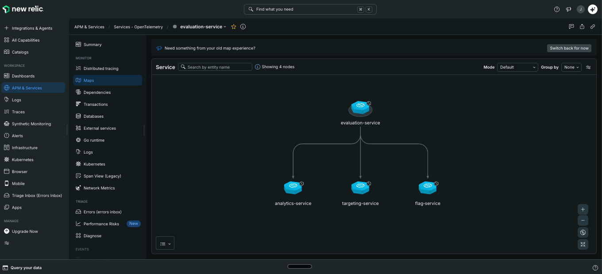
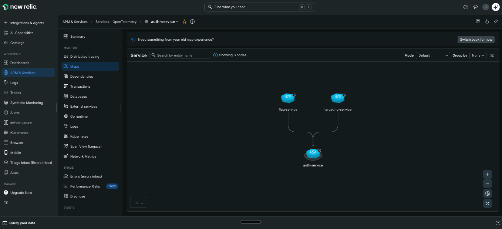
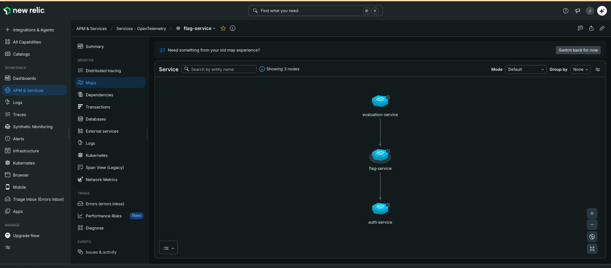

# Parte 3 — Instrumentação e APM (Traces e Visibilidade Profunda)

## 1. Ferramenta escolhida: New Relic

Escolhemos o **New Relic** como ferramenta de APM, usando a conta gratuita (região US).

**Justificativa técnica (New Relic vs Datadog)**

Optamos pelo New Relic em vez do Datadog por quatro motivos:

1. **Plano gratuito permanente.** O free tier do New Relic não expira, o que permite manter o ambiente de demonstração sem depender de um período de teste.
2. **OTLP nativo.** O New Relic recebe OpenTelemetry diretamente no endpoint `https://otlp.nr-data.net`, autenticado por uma única license key. O OpenTelemetry Collector envia traces e métricas direto para ele, sem instalar um agente próprio do fornecedor. Isso preserva o limite de 17 pods por nó do `t3.medium`, já no limite no nosso cluster.
3. **Instrumentação independente de fornecedor.** Os microsserviços usam apenas o SDK do OpenTelemetry. Para trocar de APM no futuro, basta alterar o exporter do Collector, sem mexer no código das aplicações.
4. **Distributed Tracing e Service Map prontos.** A partir dos spans OTLP, o New Relic monta o rastreamento distribuído e o mapa de dependências sem configuração adicional.

## 2. Arquitetura

```
evaluation-service ──HTTP──▶ flag-service ──HTTP──▶ auth-service
        │                  └─▶ targeting-service ──HTTP──▶ auth-service
        └──SQS (traceparent nos MessageAttributes)──▶ analytics-service ──▶ DynamoDB

Todos os serviços ──OTLP──▶ OpenTelemetry Collector (DaemonSet) ──▶ New Relic (traces)
                                                                ├─▶ Prometheus (métricas)
                                                                └─▶ Loki (logs)
```

- **Instrumentação do código.** `evaluation-service` e `auth-service` (Go) usam o SDK do OpenTelemetry (`otelhttp`, e `otelsql` no `auth-service`). `flag-service`, `targeting-service` e `analytics-service` (Python) usam `opentelemetry-instrument`, adicionado ao Dockerfile.
- **Propagação de contexto.** O contexto W3C `traceparent` viaja nas chamadas HTTP entre os serviços. Na comunicação assíncrona, o `evaluation-service` injeta o `traceparent` nos atributos da mensagem SQS e o `analytics-service` o extrai e continua o mesmo trace.
- **Exportação.** O Collector envia os traces para o New Relic via `otlphttp`. A license key fica em um Secret do Kubernetes (`otel-apm-credentials`), criado pelo Terraform e nunca versionado no Git.

## 3. Evidências

### 3.1 Todos os serviços enviam telemetria

Consulta NRQL no New Relic: `FROM Span SELECT uniques(entity.name) SINCE 30 minutes ago` retorna os cinco serviços: `evaluation-service`, `analytics-service`, `flag-service`, `auth-service` e `targeting-service`.



A lista **APM & Services → Services - OpenTelemetry** mostra os cinco serviços com provedor `opentelemetry` e taxa de erro de 0 %.



### 3.2 Distributed Tracing

Trace de uma requisição `GET /evaluate` (Trace ID `91cad9d973bea30a85c880aae94075f8`, 20 spans) que atravessa os cinco serviços:

`evaluation-service` → Redis → `flag-service` → `auth-service` (consultas SQL) → `targeting-service` → `auth-service` → fila SQS (`evaluation-events send`) → `analytics-service` (consumer) → DynamoDB `PutItem`.

Parte 1 (início do trace):



Parte 2 (restante do trace, incluindo o consumo assíncrono pelo `analytics-service`):



### 3.3 Service Map

O mapa de dependências do New Relic mostra o serviço selecionado e seus vizinhos diretos. Os três mapas abaixo, em conjunto, cobrem os cinco microsserviços:

- `evaluation-service` → `flag-service`, `targeting-service` e `analytics-service`:



- `flag-service` e `targeting-service` → `auth-service`:



- `evaluation-service` → `flag-service` → `auth-service`:



## 4. Observações

- Nas medições, o `analytics-service` aparece com tempo de resposta de cerca de 5 s. Isso **não** indica lentidão: o consumer usa *long polling* do SQS (`WaitTimeSeconds=20`) e o span de recebimento inclui a espera por mensagens.
- Algumas requisições `/evaluate` aparecem com apenas 2 entidades e 5 spans. São respostas servidas pelo **cache Redis** do `evaluation-service`, que não precisam chamar `flag-service`, `targeting-service` nem `auth-service`. Para obter o trace completo, avaliamos flags ainda não presentes no cache.
- Em uma coleta ao vivo, os dados só aparecem no New Relic depois de alguns minutos e dentro da janela de tempo selecionada.
